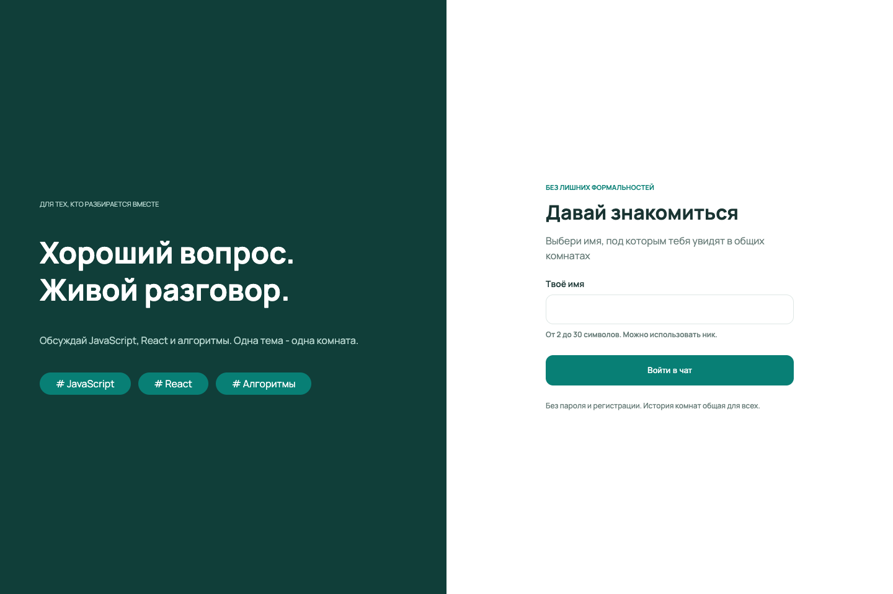
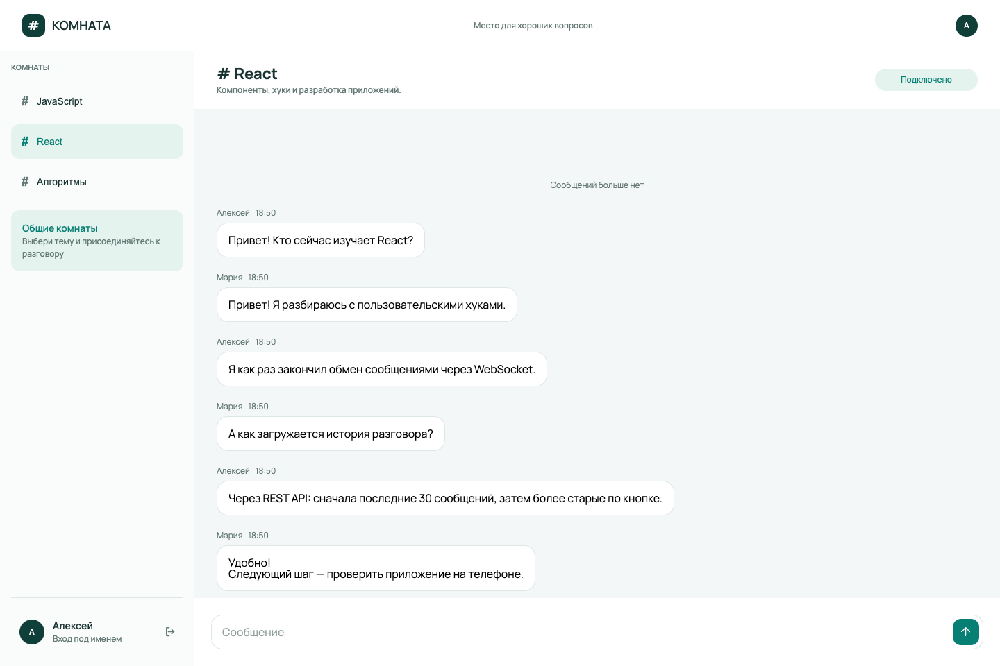
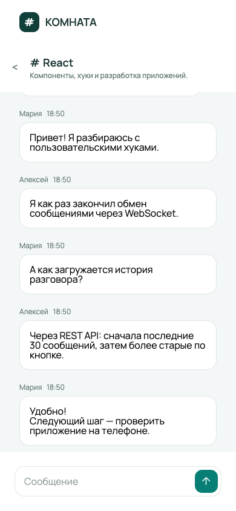

# Комната

Учебное приложение для общения в тематических комнатах. Пользователь выбирает имя, присоединяется к разговору и обменивается сообщениями с другими участниками в реальном времени.

Это мой первый проект такого объёма на React. Основная цель — разобраться во взаимодействии компонентов, управлении состоянием и работе с HTTP и WebSocket.

## Скриншоты

### Вход



### Чат на компьютере



### Мобильная версия



## Возможности

- Вход под именем с проверкой длины от 2 до 30 символов.
- Три тематические комнаты: JavaScript, React и алгоритмы.
- Отправка и получение сообщений через WebSocket.
- Многострочные сообщения: Enter — отправка, Shift + Enter — новая строка.
- Хранение истории на сервере в PostgreSQL.
- Загрузка предыдущих сообщений порциями по 30.
- Объединение истории без дубликатов и сортировка сообщений.
- Адаптивный интерфейс: на небольшом экране список комнат и разговор отображаются отдельно.
- Возврат к списку с выходом из комнаты.

Вход под именем не является аутентификацией: паролей нет, одинаковые имена разрешены.

## Технологии

**Фронтенд:** React, TypeScript, Vite, CSS Modules, браузерные Fetch API и WebSocket.

**Бэкенд:** Node.js, Express, PostgreSQL, библиотека `ws`.

## Локальный запуск

Понадобятся:

- Node.js 22.13 или новее и npm;
- установленные инструменты PostgreSQL: `initdb`, `pg_ctl`, `psql`, доступные в `PATH`.

Docker не требуется. Команды ниже выполняются из корня репозитория.

### Бэкенд

В первом терминале:

```bash
npm --prefix chat-server start
```

При первом запуске команда устанавливает зависимости сервера, подготавливает отдельную локальную базу PostgreSQL и создаёт комнаты. Для установки зависимостей нужен интернет.

Адрес сервера по умолчанию: `http://127.0.0.1:3001`.

### Фронтенд

Во втором терминале:

```bash
npm ci
npm run dev
```

Открой адрес, который выведет Vite, обычно `http://localhost:5173`.

Адрес бэкенда задаётся в `src/api/config.ts`. Для стандартного локального запуска:

```ts
export const restUrl = new URL('http://127.0.0.1:3001')
```

Для остановки используй Ctrl+C в каждом терминале. История сообщений сохраняется между запусками.

Дополнительные настройки сервера описаны в [README бэкенда](chat-server/README.md).

## Как устроено приложение

- `App` проверяет доступность сервера и отображает вход или чат.
- `useChat` управляет соединением, идентификацией, вступлением в комнаты, отправкой сообщений и загрузкой истории.
- Reducer в `chatReducer.ts` обновляет состояния соединения, комнаты, истории и отправки.
- HTTP-запросы используются для получения комнат и истории.
- WebSocket используется для команд и получения новых сообщений.
- Компоненты отображают состояние и передают действия пользователя в обработчики.

При обработке ответов используются проверки актуальности комнаты и идентификаторов запросов. Сообщения объединяются по серверному ID.

[Документация REST API и WebSocket](chat-server/docs/API.md).

## Проверки

Из корня проекта:

```bash
npm run build
npm run lint
```

Интеграционные тесты бэкенда:

```bash
npm --prefix chat-server test
```

Для тестов также необходимы инструменты PostgreSQL. Тесты используют отдельную временную базу.

## Ограничения текущей версии

- Нет регистрации, паролей и личных комнат.
- Нет автоматического переподключения и повторной отправки сообщений.
- Обработка ошибок реализована частично.
- При дозагрузке истории точная позиция чтения пока не сохраняется.
- Открытие с телефона по локальному HTTP-адресу требует дополнительной настройки: используемый `crypto.randomUUID()` доступен только в безопасном контексте (HTTPS или локальный адрес вроде `localhost`). На телефоне `localhost` означает сам телефон.

## Мой вклад

Фронтенд и его интеграцию с API я реализовал самостоятельно, используя документацию, консультации и ревью с помощью ИИ. Бэкенд подготовлен с помощью ИИ.

В процессе работы я разобрался с эффектами, пользовательскими хуками, управлением состоянием через reducer, взаимодействием по WebSocket, пагинацией и адаптивной вёрсткой.
Научился разделять состояния на независимые участки.
